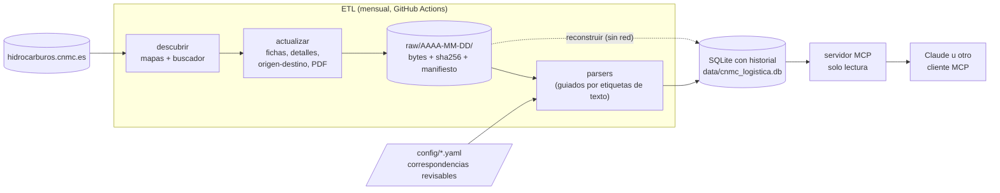

# mcp-logistica-hidrocarburos-cnmc

[](https://github.com/mariogmg/mcp-logistica-hidrocarburos-cnmc/actions/workflows/ci.yml)

Histórico de la **logística de productos petrolíferos** que publica la CNMC, consultable en
lenguaje natural a través de un servidor [MCP](https://modelcontextprotocol.io) de solo lectura.

> **Aviso legal.** Proyecto no oficial, no afiliado a la CNMC ni a ningún operador. Los datos
> son públicos y los publica la CNMC en
> [hidrocarburos.cnmc.es](https://hidrocarburos.cnmc.es/hidrocarburos/instalaciones_nacionales.htm).
> Este repositorio los copia y los estructura tal cual, sin garantía de exactitud ni de
> actualización. Para cualquier decisión, consulte la fuente original.

## Qué es

La CNMC publica las condiciones de acceso a las instalaciones de almacenamiento y transporte de
productos petrolíferos de todos los operadores: precios, mermas, servicios incluidos, rutas
origen-destino y capacidades. El portal solo muestra el estado actual y cada operador redacta sus
servicios a su manera.

Este proyecto:

1. **Descarga** una vez al mes todo el portal (unas 600 páginas y PDF), con educación: una
   petición por segundo como máximo, `robots.txt` en cada ejecución y un User-Agent identificable.
2. **Guarda el crudo** tal cual (`raw/AAAA-MM-DD/`, con sha256 y manifiesto) y **nunca borra
   nada**: cada cambio de un precio o de una condición se conserva como una versión nueva.
3. **Normaliza** lo justo para poder comparar: categoría de servicio, tipo de precio, unidad,
   qué incluye cada servicio.
4. **Lo expone** mediante un servidor MCP que solo lee una base SQLite. El servidor nunca hace
   scraping.

Con la foto del 11/11/2026: 115 instalaciones (71 de almacenamiento y 44 aeroportuarias),
258 detalles (un producto en una instalación), 31 operadores con instalaciones, 1.579 precios
de las páginas, 2.163 rutas origen-destino y 27 PDF leídos por completo (66 precios de
tarifas, 2.495 celdas de matrices, 18 bonificaciones, 21 condiciones con cantidad y 365
capacidades).

## Cómo funciona



- **ETL y servidor están separados.** El servidor no importa ni una línea del descargador o de
  los parsers (hay un test que lo comprueba).
- **El crudo es la fuente de verdad.** La base se puede regenerar entera desde `raw/` con
  `reconstruir`; por eso un fallo de interpretación nunca pierde información.
- **Nada aborta por contenido inesperado.** Un bloque o un PDF que no se entiende se anota en la
  tabla `incidencias` (recurso, operador y texto), se conserva su crudo y se sigue. La orden
  termina con código distinto de cero si hubo errores, para que el workflow se marque en rojo.

## Instalación

Requiere [uv](https://docs.astral.sh/uv/) (instala Python 3.12 por su cuenta).

```bash
git clone https://github.com/mariogmg/mcp-logistica-hidrocarburos-cnmc
cd mcp-logistica-hidrocarburos-cnmc
uv sync
uv run cnmc-logistica info
```

El repositorio incluye la base de datos ya cargada (`data/cnmc_logistica.db`), así que el servidor
funciona sin descargar nada.

## Uso

### Consultar los datos desde Claude Desktop

Añade a la configuración de Claude Desktop el bloque de
[ejemplos/claude_desktop_config.json](ejemplos/claude_desktop_config.json) (cambiando la ruta) y
reinicia. Más detalles, incluido el transporte HTTP, en [ejemplos/LEEME.md](ejemplos/LEEME.md).

### Órdenes de la CLI

| Orden | Qué hace | ¿Usa la red? |
|---|---|---|
| `descubrir` | Mapas + buscador → `config/inventario.json`, con control cruzado | Sí |
| `actualizar` | Descarga todo el inventario a `raw/` y carga la foto en la base | Sí |
| `reconstruir` | Crea una base nueva a partir de todas las fotos de `raw/` | No |
| `servir` | Arranca el servidor MCP (`--transporte stdio` o `streamable-http`) | No |
| `info` | Versión, fotos disponibles y filas de cada tabla | No |

```bash
uv run cnmc-logistica descubrir      # ~1 min si ya hay foto del día; ~4 min desde cero
uv run cnmc-logistica actualizar     # ~10 min desde cero (1 petición por segundo)
uv run cnmc-logistica reconstruir --salida /tmp/nueva.db
uv run cnmc-logistica servir --transporte streamable-http --puerto 8000
```

Variables de entorno del servidor HTTP: `CNMC_MCP_TOKEN` (si se define, se exige como token
Bearer) y `CNMC_MCP_HOSTS_PERMITIDOS` (cabeceras `Host` admitidas, separadas por comas; por
defecto solo local). `CNMC_BD` cambia la ruta de la base.

### Docker

```bash
docker build -t cnmc-logistica .
docker run --rm -p 8000:8000 cnmc-logistica      # MCP en http://localhost:8000/mcp
```

## Herramientas MCP

| Herramienta | Para qué |
|---|---|
| `estado` | Última foto, volumen de datos, incidencias y esquema de tablas |
| `listar_operadores` | Operadores con su nº de instalaciones por tipo y nombres anteriores |
| `listar_instalaciones` | Filtros por operador, tipo, comunidad y producto |
| `ver_instalacion` | Ficha completa: detalles, precios, condiciones y capacidad |
| `buscar_precios` | Precios vigentes (de la página y de los PDF, con su `fuente`) por operador, categoría, producto, comunidad o texto |
| `comparar_servicio` | Compara una categoría entre instalaciones y operadores, solo entre comparables |
| `historial_precio` | Todas las versiones de los precios de un detalle |
| `precios_origen_destino` | Coste de llevar producto de un origen a una instalación |
| `capacidades` | Capacidad (miles de m³) por compañía, instalación y producto |
| `reconsignaciones` | Matrices de los PDF: reconsignación entre instalaciones, consignación de éster y origen-destino |
| `bonificaciones` | Bonificaciones y compensaciones de los contratos a largo plazo |
| `consulta_sql` | Un `SELECT` libre, con cuatro capas de protección de solo lectura |

### Ejemplos de preguntas

- ¿Cuántos operadores hay y cuántas instalaciones tiene cada uno?
- ¿Qué cuota de instalaciones tiene Exolum por tipo?
- Compara el precio de almacenamiento de queroseno en aeropuertos, separando «almacenamiento» de
  «servicios aeroportuarios».
- ¿Qué operadores ofrecen almacenamiento en Canarias y a qué precio?
- ¿Qué mermas aplican los distintos operadores al gasóleo?
- ¿Cuánto cuesta llevar producto desde Huelva hasta Cartagena?
- ¿Ha cambiado el precio de las transferencias de Exolum en Puxeiros?
- ¿Cuánto cuesta reconsignar gasóleo de Huelva a Zaragoza?
- ¿Qué bonificaciones tienen los contratos a largo plazo de queroseno?
- ¿Cuánto cobra DISA por los servicios logísticos de gasolinas en cada isla?

## Modelo de datos

Dos niveles de identificador, los mismos que usa el portal: **instalación** (`id_tanque`) y
**detalle** (`id_tanque_instalacion`, un producto dentro de una instalación). Los precios cuelgan
del detalle, y cada detalle tiene su propio titular.

| Tabla | Contenido |
|---|---|
| `operadores`, `operadores_nombres` | Código estable del buscador e historial de sus nombres |
| `instalaciones` | Tipo (almacenamiento / aeroportuaria) y comunidad |
| `detalles`, `detalle_productos` | Titular, conexión a oleoducto y productos normalizados |
| `precios` | Un valor por fila, con `categoria_servicio`, `tipo_precio`, `tipo_valor` y unidad |
| `condiciones` | Mermas y demás condiciones (valor numérico si lo hay, y texto) |
| `servicios_incluidos` | Lista «Incluye:» de cada servicio principal |
| `precios_origen_destino`, `notas_origen_destino` | Rutas (`ofrecida` / `no_ofrecida`) y notas al pie |
| `capacidades` | PDF global de capacidades, enlazado a `id_tanque` |
| `documentos`, `filas_documento` | Metadatos y tablas genéricas de cada PDF |
| `enlaces_documento` | Qué línea de precios de qué detalle remite a qué PDF |
| `precios_pdf` | Tarifas de los PDF (concepto → precio), con categoría, unidad y año |
| `matrices_pdf` | Matrices origen × destino de los PDF (vista `reconsignaciones`) |
| `bonificaciones` | Bonificaciones y compensaciones: tramo, condición, valor y unidad |
| `condiciones_pdf` | Cantidades con unidad dentro de las notas (plazos en días, mínimos en toneladas…) |
| `notas_pdf` | Texto íntegro de las notas solo explicativas de cada PDF |
| `cobertura_pdf` | Por PDF: cifras totales, guardadas, descartadas y sin cubrir |
| `ejecuciones`, `incidencias` | Registro de cada carga: altas, cambios, desapariciones y avisos |

Cada `actualizar` deja además su resumen (fecha y hora, versión, cifras e incidencias) en
`raw/AAAA-MM-DD/ejecuciones.jsonl`. Así `reconstruir` recupera el historial de ejecuciones
reales (`origen = 'registro'`) y se anota a sí misma como un evento `tipo = 'reconstruccion'`.

### Historial (SCD tipo 2)

Cada fila lleva `primera_vez_visto` y `ultima_vez_visto` (fechas de foto). Si el dato sigue igual
solo avanza `ultima_vez_visto`; si cambia, la fila antigua se queda y se inserta otra. Unos
*triggers* rechazan cualquier `DELETE` y cualquier `UPDATE` que no sea avanzar `ultima_vez_visto`.
Las vistas `<tabla>_vigentes` muestran lo visto en la última foto. `fecha_precio` es la vigencia
que publica la CNMC (puede faltar) y `anio_tabla` el año cuando la fuente solo da el año.

### Cómo se evita comparar servicios distintos

- `tipo_precio`: `numerico`, `regla` («según contrato», «coste real + 3 %»…), `texto` o `pdf`
  (remite a un documento). Si no es numérico, `valor` es nulo y se guarda el texto original.
- `tipo_valor`: `unico`, `max` o `min`, cada uno con su fecha.
- `categoria_servicio`: sale de [config/categorias_servicio.yaml](config/categorias_servicio.yaml)
  (etiqueta + tipo de instalación → categoría). No hay expresiones regulares que adivinen: lo que
  no está en el fichero queda como `sin_categoria` y genera un aviso.
- Indicadores `incluye_transporte`, `incluye_almacenamiento`, `incluye_expedicion` e
  `incluye_puesta_a_bordo`, derivados de la lista «Incluye:» mediante
  [config/indicadores_incluye.yaml](config/indicadores_incluye.yaml).
- `comparar_servicio` solo agrupa precios con la misma categoría, los mismos indicadores y la
  misma unidad, y avisa cuando hay más de un grupo.

### Los PDF, leídos por completo

Muchos precios no están en la página: el detalle remite a un PDF. Cada tipo de PDF tiene su
parser (elegido por el título del documento, no por su número) que trabaja sobre palabras con
coordenadas, y cada valor guarda página, posición y texto original para poder auditarlo.

- **Sin punteros sueltos.** La vista `lineas_pdf_sin_resolver` lista las líneas con
  `tipo_precio = 'pdf'` cuyo documento no tiene datos estructurados; debe estar vacía, y si
  no lo está la carga registra un error.
- **Cobertura comprobada en cada carga.** Todas las palabras con cifras de cada PDF deben
  estar en la base (como valor, dentro de una etiqueta o en una nota guardada) o en la lista de
  descartes justificados de [config/descartes_pdf.yaml](config/descartes_pdf.yaml). Una cifra
  que no esté en ningún sitio es un error `cifra_pdf_sin_cubrir` y la ejecución termina en rojo.
  El resultado queda en la tabla `cobertura_pdf`.
- **Nada se inventa.** Una cifra que no se puede interpretar con certeza (p. ej. «01021», sin
  coma) se guarda con valor nulo, su texto original y un aviso.
- **OCR solo de respaldo.** Si una página no tiene capa de texto se lee con Tesseract
  (`uv sync --extra ocr`); esos valores llevan `metodo = 'ocr'` y generan un aviso para
  revisarlos. Nunca se pasa OCR a una página que ya tiene texto.
- **Sin repeticiones.** Una tarifa en PDF vale para todos los detalles que remiten a ella:
  `buscar_precios` y `comparar_servicio` la devuelven una sola vez, con `aplica_a` (nº de
  detalles e instalaciones, y la lista con `detallar_aplicacion=true`).
- **Enlace por datos, no por nombres.** Cada fila de las tablas origen-destino del PDF se une
  al detalle cuyos precios en la página web son exactamente los mismos; las matrices de
  reconsignación heredan esa identificación por nombre exacto.

## Decisiones de diseño

| Decisión | Motivo |
|---|---|
| Crudo inmutable + base reconstruible | Un fallo de un parser se arregla sin perder ni volver a descargar nada |
| Parsers guiados por etiquetas de texto («PRODUCTOS:», «Incluye:»…) | El texto visible cambia menos que las clases CSS |
| Correspondencias en YAML revisable | Las decisiones de negocio se leen y se discuten sin leer código |
| Operador = código del buscador | Los nombres cambian (Cepsa → Moeve); el código no |
| Control cruzado fichas ↔ buscador y HTML ↔ PDF | Detecta descargas incompletas; ya cazó un fallo real de paginación |
| Peticiones sin cookies | El buscador guarda la página en la sesión y contaminaba la búsqueda siguiente |
| Decodificación cabecera → UTF-8 → ISO-8859-1 | El portal declara ISO-8859-1 en el `<meta>` pero sirve UTF-8 |
| `0,00` = ruta no ofrecida | En origen-destino un cero no es un precio; se guarda `NULL` + estado |
| SQLite en el repositorio | Clonar basta para consultar; el histórico viaja con el código |

## Actualización automática y reconstrucción

- **CI** en cada push: `ruff` y `pytest` (los tests usan páginas reales guardadas como fixtures y
  no tocan la red).
- **Actualización mensual** (día 2): ejecuta `descubrir` y `actualizar`, hace commit de la base
  y del inventario, y sube `raw/AAAA-MM-DD` como `.tar.gz` a una
  [Release](https://github.com/mariogmg/mcp-logistica-hidrocarburos-cnmc/releases). Si hubo
  errores, el trabajo queda en rojo después de conservar todo lo descargado.

Para reconstruir la base desde cero en cualquier máquina bastan dos órdenes:

```bash
uv run cnmc-logistica descargar-releases     # baja a raw/ todo el crudo publicado
uv run cnmc-logistica reconstruir --reemplazar
```

`descargar-releases` baja todos los ficheros de todas las Releases `raw-*`, comprueba su
sha256, deja cada foto en `raw/AAAA-MM-DD/` (las descargas adicionales de un mismo día, en
`_ejecuciones/N/`) y une sus `ejecuciones.jsonl` sin duplicar líneas. `reconstruir` recupera
así todas las actualizaciones reales y añade la reconstrucción como un evento propio.

## Limitaciones conocidas

- El histórico empieza el 11/11/2026; no hay datos anteriores.
- La provincia no se publica de forma estructurada y no se guarda en esta versión.
- El portal no fecha las rutas origen-destino: solo se conoce el año de la tabla (del PDF).
- Los productos se separan por comas y por « y », sin fusionar variantes («Gasóleo marino» y
  «Gasóleos marinos» son dos valores).
- Un PDF de un tipo nuevo no tiene parser: se registra el error `pdf_sin_parser`, sus cifras
  quedan sin cubrir y hay que escribirle uno. Es deliberado: no se adivina su estructura.
- Los precios de los PDF solo tienen año (`anio_tabla`), no fecha de vigencia.
- El PDF de búnker de Exolum no indica la unidad de sus precios; se guarda nula.
- Hasta hoy ningún PDF ha necesitado OCR; el respaldo está probado con una página escaneada
  de prueba.

## Desarrollo

```bash
uv sync
uv run ruff check . && uv run ruff format --check .
uv run pytest
```

## Licencia

Código bajo licencia [MIT](LICENSE). Los datos son de la CNMC y de los operadores que los
declaran.
