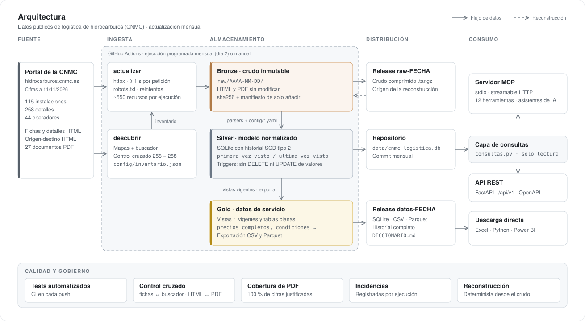

# logistica-hidrocarburos-cnmc

[](https://github.com/mariogmg/logistica-hidrocarburos-cnmc/actions/workflows/ci.yml)

Pipeline de ingeniería de datos que convierte la información pública de logística de hidrocarburos de la CNMC en un dataset histórico, verificado y actualizado cada mes.

Extracción (HTML y PDF) · Modelo con historial SCD2 · Capas bronze/silver/gold · Publicación mensual en CSV, Parquet y SQLite · API REST y servidor MCP

> **Aviso legal.** Proyecto no oficial, no afiliado a la CNMC ni a ningún operador. Los datos
> son públicos y los publica la CNMC en
> [hidrocarburos.cnmc.es](https://hidrocarburos.cnmc.es/hidrocarburos/instalaciones_nacionales.htm).
> Este repositorio los copia y los estructura tal cual, sin garantía de exactitud ni de
> actualización. Para cualquier decisión, consulte la fuente original.

## Cómo usarlo

Hay dos formas de uso: descargar los datos de la última Release `datos-*`, o clonar el
repositorio y consultarlos con un cliente MCP o con la API REST local.

### 1. Descargar los datos

Cada mes se publica una Release
[`datos-AAAA-MM-DD`](https://github.com/mariogmg/logistica-hidrocarburos-cnmc/releases)
con la capa gold y la capa silver completa. Su uso no requiere instalar el proyecto. Contiene
seis ficheros:

| Fichero | Contenido |
|---|---|
| `csv.zip` | 26 ficheros CSV con las filas vigentes: 4 tablas planas (`precios_completos`, `condiciones_completas`, `origen_destino_completo`, `capacidades_completas`) con operador, instalación, comunidad, producto, categoría, valor, unidad, fecha y enlace a la página de la CNMC; y las 22 tablas normalizadas. UTF-8 con BOM, separador `;` y coma decimal (formato de Excel en español) |
| `parquet.zip` | Las mismas 26 tablas en Parquet, con tipos de columna |
| `historial_parquet.zip` | 20 ficheros Parquet, uno por tabla con historial, con todas las versiones de cada fila y una columna `vigente`. El portal de la CNMC solo publica el estado actual |
| `cnmc_logistica.db` | Base SQLite completa: historial, vistas `<tabla>_vigentes` y registro de ejecuciones |
| `cnmc_logistica.db.sha256` | Huella sha256 de la base |
| `DICCIONARIO.md` | Descripción de cada tabla y columna, unidades y lectura del historial |

```python
import pandas as pd

precios = pd.read_parquet("historial/precios.parquet")
cambios = precios[precios.vigente == 0]  # versiones anteriores y precios retirados
```

### 2. Consultarlos clonando el repositorio

Requiere [uv](https://docs.astral.sh/uv/), que instala Python 3.12. El repositorio incluye la
base cargada (`data/cnmc_logistica.db`). El servidor solo lee esa base; no hace peticiones al
portal de la CNMC.

```bash
git clone https://github.com/mariogmg/logistica-hidrocarburos-cnmc
cd logistica-hidrocarburos-cnmc
uv sync
uv run cnmc-logistica info
```

**Cliente MCP.** El servidor usa el transporte stdio por defecto. Para Claude Desktop, añadir
este bloque a su fichero de configuración con la ruta del repositorio y reiniciar la aplicación.
El bloque está también en
[ejemplos/claude_desktop_config.json](ejemplos/claude_desktop_config.json); las rutas del
fichero de configuración y el transporte HTTP están en [ejemplos/LEEME.md](ejemplos/LEEME.md).

```json
{
  "mcpServers": {
    "logistica-hidrocarburos-cnmc": {
      "command": "uv",
      "args": ["run", "--directory", "/RUTA/A/logistica-hidrocarburos-cnmc", "cnmc-logistica", "servir"]
    }
  }
}
```

**API REST local.** Con el transporte HTTP, la misma aplicación sirve el MCP en `/mcp`, la API
REST en `/api/v1` (14 rutas `GET`, paginadas con `limit` y `offset`), la comprobación `/salud`
y la documentación OpenAPI en <http://localhost:8000/docs>:

```bash
uv run cnmc-logistica servir --transporte http
curl "http://localhost:8000/api/v1/precios?categoria=almacenamiento&limit=5"
```

El despliegue en un servidor (MCP y API detrás de Caddy con HTTPS) es opcional y está
documentado en [despliegue/LEEME.md](despliegue/LEEME.md). No hay ninguna instancia pública.

## Qué es

La CNMC publica las condiciones de acceso a las instalaciones de almacenamiento y transporte de
productos petrolíferos de todos los operadores: precios, mermas, servicios incluidos, rutas
origen-destino y capacidades. El portal solo muestra el estado actual, y cada operador describe
sus servicios con sus propios términos.

Este proyecto:

1. **Descarga** el portal una vez al mes (569 recursos entre páginas HTML y PDF en la primera
   ejecución, el 11/11/2026), con un intervalo mínimo de 1 s entre peticiones, reintentos con
   espera exponencial y un User-Agent que identifica el proyecto. Consulta `robots.txt` en cada
   ejecución.
2. **Bronze: guarda el crudo** sin modificar en `raw/AAAA-MM-DD/`, con el sha256 de cada fichero
   y un manifiesto al que solo se añaden líneas.
3. **Silver: carga un modelo normalizado con historial** en SQLite. No se borra ni se
   sobrescribe ninguna fila: cada cambio de un precio o de una condición es una versión nueva.
   La normalización se limita a lo necesario para comparar: categoría de servicio, tipo de
   precio, unidad y servicios incluidos.
4. **Gold: publica** las vistas vigentes y cuatro tablas planas en CSV y Parquet, en una Release
   mensual.
5. **Sirve** los datos con una API REST y un servidor MCP que solo leen la base SQLite.

Cifras de la foto del 11/11/2026: 115 instalaciones (71 de almacenamiento y 44 aeroportuarias),
258 detalles (un producto en una instalación), 44 operadores en el buscador de la CNMC (31 con
instalaciones), 1.579 precios de las páginas, 2.163 rutas origen-destino y 27 PDF (66 precios
de tarifas, 2.495 celdas de matrices, 18 bonificaciones, 21 condiciones con cantidad y 365
capacidades). Las 3.237 cifras de esos PDF están en la base o en la lista de descartes
justificados.

## Arquitectura



Bronze: crudo inmutable de cada ejecución. Silver: modelo normalizado con historial. Gold: vistas vigentes y tablas planas para consumo.

- **ETL y servidor están separados.** El servidor, la API y la capa de consultas no importan el
  descargador ni los parsers. Tres tests lo comprueban.
- **La capa bronze es la fuente de verdad.** `reconstruir` regenera la capa silver completa a
  partir de `raw/`, sin red. Un error de interpretación se corrige sin volver a descargar.
- **El contenido inesperado no detiene la carga.** Un bloque o un PDF que no se puede
  interpretar se registra en la tabla `incidencias` (recurso, operador y texto), su crudo se
  conserva y la carga continúa. Si hubo errores, la orden termina con código distinto de cero y
  el workflow queda marcado como fallido.

## Uso

La consulta de los datos se describe en [Cómo usarlo](#cómo-usarlo). La descarga del portal y
la carga de la base requieren las dependencias del ETL: `uv sync --extra etl`. `exportar`
requiere además `--extra exportar` para generar Parquet.

### Órdenes de la CLI

| Orden | Qué hace | ¿Usa la red? |
|---|---|---|
| `descubrir` | Recorre los mapas y el buscador y escribe `config/inventario.json`, con control cruzado entre ambos | Sí |
| `actualizar` | Descarga el inventario a `raw/` (bronze) y carga la foto en la base (silver) | Sí |
| `reconstruir` | Crea una base nueva a partir de todas las fotos de `raw/` | No |
| `exportar` | Genera los ficheros de la Release `datos-*`: base, sha256, CSV, Parquet y diccionario | No |
| `descargar-releases` | Descarga a `raw/` el crudo publicado en las Releases `raw-*` | Solo GitHub |
| `servir` | Arranca el MCP (`--transporte stdio`) o el MCP y la API REST (`--transporte http`) | No |
| `info` | Versión, fotos disponibles y filas de cada tabla | No |

```bash
uv run cnmc-logistica descubrir
uv run cnmc-logistica actualizar     # al menos 1 s por recurso
uv run cnmc-logistica reconstruir --salida /tmp/nueva.db
uv run cnmc-logistica exportar --salida exportacion
uv run cnmc-logistica servir --transporte http --puerto 8000
```

Variables de entorno del servidor:

| Variable | Efecto |
|---|---|
| `CNMC_BD` | Ruta de la base que se sirve. Por defecto, `data/cnmc_logistica.db` |
| `CNMC_MCP_TOKEN` | Si se define, `/mcp` exige ese token Bearer. No afecta a la API REST |
| `CNMC_MCP_HOSTS_PERMITIDOS` | Cabeceras `Host` admitidas en `/mcp`, separadas por comas. Por defecto, solo las locales |

### Docker

```bash
docker build -t cnmc-logistica .
docker run --rm -p 8000:8000 cnmc-logistica      # MCP en /mcp y API REST en /api/v1
```

## Herramientas MCP

El servidor MCP expone 12 herramientas de solo lectura. La API REST usa la misma capa de
consultas (`consultas.py`), por lo que ambas devuelven los mismos datos. El SQL libre solo
está disponible en el MCP.

| Herramienta | Función |
|---|---|
| `estado` | Última foto, volumen de datos, incidencias y esquema de tablas |
| `listar_operadores` | Operadores con su nº de instalaciones por tipo y nombres anteriores |
| `listar_instalaciones` | Filtros por operador, tipo, comunidad y producto |
| `ver_instalacion` | Ficha completa: detalles, precios, condiciones y capacidad |
| `buscar_precios` | Precios vigentes (de la página y de los PDF, con su `fuente`) por operador, categoría, producto, comunidad o texto |
| `comparar_servicio` | Compara una categoría entre instalaciones y operadores, solo entre comparables |
| `historial_precio` | Todas las versiones de los precios de un detalle |
| `precios_origen_destino` | Coste de llevar producto de un origen a una instalación |
| `capacidades` | Capacidad (miles de m³) por compañía, instalación y producto |
| `reconsignaciones` | Matrices de los PDF: reconsignación entre instalaciones, consignación de éster y origen-destino |
| `bonificaciones` | Bonificaciones y compensaciones de los contratos a largo plazo |
| `consulta_sql` | Una sentencia `SELECT`, con cuatro protecciones: base abierta en solo lectura, `query_only`, autorizador que solo admite lectura y límite de trabajo y de filas |

### Ejemplos de preguntas para un cliente MCP

- ¿Cuántos operadores hay y cuántas instalaciones tiene cada uno?
- ¿Qué cuota de instalaciones tiene Exolum por tipo?
- Compara el precio de almacenamiento de queroseno en aeropuertos, separando «almacenamiento» de
  «servicios aeroportuarios».
- ¿Qué operadores ofrecen almacenamiento en Canarias y a qué precio?
- ¿Qué mermas aplican los distintos operadores al gasóleo?
- ¿Cuánto cuesta llevar producto desde Huelva hasta Cartagena?
- ¿Ha cambiado el precio de las transferencias de Exolum en Puxeiros?
- ¿Cuánto cuesta reconsignar gasóleo de Huelva a Zaragoza?
- ¿Qué bonificaciones tienen los contratos a largo plazo de queroseno?
- ¿Cuánto cobra DISA por los servicios logísticos de gasolinas en cada isla?

## Modelo de datos

La capa silver tiene 22 tablas: 20 con historial y 2 de registro (`ejecuciones` e
`incidencias`). Usa los dos niveles de identificador del portal: **instalación** (`id_tanque`)
y **detalle** (`id_tanque_instalacion`, un producto dentro de una instalación). Los precios
pertenecen al detalle, y cada detalle tiene su titular.

| Tabla | Contenido |
|---|---|
| `operadores`, `operadores_nombres` | Código estable del buscador e historial de sus nombres |
| `instalaciones` | Tipo (almacenamiento / aeroportuaria) y comunidad |
| `detalles`, `detalle_productos` | Titular, conexión a oleoducto y productos normalizados |
| `precios` | Un valor por fila, con `categoria_servicio`, `tipo_precio`, `tipo_valor` y unidad |
| `condiciones` | Mermas y demás condiciones (valor numérico si lo hay, y texto) |
| `servicios_incluidos` | Lista «Incluye:» de cada servicio principal |
| `precios_origen_destino`, `notas_origen_destino` | Rutas (`ofrecida` / `no_ofrecida`) y notas al pie |
| `capacidades` | PDF global de capacidades, enlazado a `id_tanque` |
| `documentos`, `filas_documento` | Metadatos y tablas genéricas de cada PDF |
| `enlaces_documento` | Qué línea de precios de qué detalle remite a qué PDF |
| `precios_pdf` | Tarifas de los PDF (concepto → precio), con categoría, unidad y año |
| `matrices_pdf` | Matrices origen × destino de los PDF (vista `reconsignaciones`) |
| `bonificaciones` | Bonificaciones y compensaciones: tramo, condición, valor y unidad |
| `condiciones_pdf` | Cantidades con unidad dentro de las notas (plazos en días, mínimos en toneladas…) |
| `notas_pdf` | Texto íntegro de las notas solo explicativas de cada PDF |
| `cobertura_pdf` | Por PDF: cifras totales, guardadas, descartadas y sin cubrir |
| `ejecuciones`, `incidencias` | Registro de cada carga: altas, cambios, desapariciones y avisos |

La capa gold son las vistas `<tabla>_vigentes` y las cuatro tablas planas de la Release
(`precios_completos`, `condiciones_completas`, `origen_destino_completo` y
`capacidades_completas`), descritas en `DICCIONARIO.md`.

Cada `actualizar` escribe su resumen (fecha y hora, versión, cifras e incidencias) en
`raw/AAAA-MM-DD/ejecuciones.jsonl`. `reconstruir` recupera de ahí las ejecuciones originales
(`origen = 'registro'`) y se registra a sí misma con `tipo = 'reconstruccion'`.

### Historial (SCD tipo 2)

Cada fila lleva `primera_vez_visto` y `ultima_vez_visto` (fechas de foto). Si el dato sigue igual
solo avanza `ultima_vez_visto`; si cambia, la fila antigua se conserva y se inserta otra. Los
*triggers* de la base rechazan cualquier `DELETE` y cualquier `UPDATE` que no sea avanzar
`ultima_vez_visto`.
Las vistas `<tabla>_vigentes` muestran lo visto en la última foto. `fecha_precio` es la vigencia
que publica la CNMC (puede faltar) y `anio_tabla` el año cuando la fuente solo da el año.

### Cómo se evita comparar servicios distintos

- `tipo_precio`: `numerico`, `regla` («según contrato», «coste real + 3 %»…), `texto` o `pdf`
  (remite a un documento). Si no es numérico, `valor` es nulo y se guarda el texto original.
- `tipo_valor`: `unico`, `max` o `min`, cada uno con su fecha.
- `categoria_servicio`: sale de [config/categorias_servicio.yaml](config/categorias_servicio.yaml)
  (etiqueta + tipo de instalación → categoría). No se infiere con expresiones regulares: una
  etiqueta que no está en el fichero queda como `sin_categoria` y genera un aviso.
- Indicadores `incluye_transporte`, `incluye_almacenamiento`, `incluye_expedicion` e
  `incluye_puesta_a_bordo`, derivados de la lista «Incluye:» mediante
  [config/indicadores_incluye.yaml](config/indicadores_incluye.yaml).
- `comparar_servicio` solo agrupa precios con la misma categoría, los mismos indicadores y la
  misma unidad, y avisa cuando hay más de un grupo.

### Extracción de los PDF

Parte de los precios no está en la página: el detalle remite a un PDF. Cada tipo de PDF tiene
un parser, elegido por el título del documento, que trabaja sobre palabras con coordenadas.
Cada valor guarda página, posición y texto original para su auditoría.

- **Todas las remisiones a PDF se resuelven.** La vista `lineas_pdf_sin_resolver` lista las líneas con
  `tipo_precio = 'pdf'` cuyo documento no tiene datos estructurados; debe estar vacía, y si
  no lo está la carga registra un error.
- **La cobertura se comprueba en cada carga.** Cada palabra con cifras de cada PDF debe estar
  en la base (como valor, dentro de una etiqueta o en una nota guardada) o en la lista de
  descartes justificados de [config/descartes_pdf.yaml](config/descartes_pdf.yaml). Una cifra
  sin cubrir es un error `cifra_pdf_sin_cubrir` y la ejecución termina como fallida. El
  resultado se guarda en la tabla `cobertura_pdf`. En la foto del 11/11/2026: 3.237 cifras,
  97 descartadas con justificación, 1 ilegible y 0 sin cubrir.
- **No se infieren valores.** Una cifra que no se puede interpretar con certeza (p. ej.
  «01021», sin coma) se guarda con valor nulo, su texto original y un aviso.
- **El OCR es un respaldo.** Una página sin capa de texto se lee con Tesseract
  (`uv sync --extra ocr`). Esos valores llevan `metodo = 'ocr'` y generan un aviso de revisión.
  El OCR no se aplica a páginas con capa de texto.
- **Las tarifas compartidas no se repiten en las consultas.** Una tarifa en PDF se aplica a
  todos los detalles que remiten a ella. `buscar_precios` y `comparar_servicio` la devuelven una
  vez, con `aplica_a` (nº de detalles e instalaciones, y la lista con
  `detallar_aplicacion=true`). En la tabla plana `precios_completos` aparece una vez por detalle.
- **El enlace se hace por datos, no por nombres.** Cada fila de las tablas origen-destino del PDF se une
  al detalle cuyos precios en la página web son exactamente los mismos; las matrices de
  reconsignación heredan esa identificación por nombre exacto.

## Decisiones de diseño

| Decisión | Motivo |
|---|---|
| Capa bronze inmutable y capa silver reconstruible | Un error de un parser se corrige sin perder datos y sin volver a descargar |
| Parsers guiados por etiquetas de texto («PRODUCTOS:», «Incluye:»…) | El texto visible cambia menos que las clases CSS |
| Correspondencias en ficheros YAML | Las reglas de negocio se revisan sin leer código |
| Operador = código del buscador | Los nombres cambian (Cepsa → Moeve); el código no |
| Control cruzado fichas ↔ buscador y HTML ↔ PDF | Detecta descargas incompletas; detectó un error de paginación durante el desarrollo |
| Peticiones sin cookies | El buscador guarda la paginación en la sesión, lo que alteraba la búsqueda siguiente |
| Decodificación cabecera → UTF-8 → ISO-8859-1 | El portal declara ISO-8859-1 en el `<meta>` pero sirve UTF-8 |
| `0,00` = ruta no ofrecida | En origen-destino un cero no es un precio; se guarda `NULL` + estado |
| SQLite en el repositorio | La consulta solo requiere clonar; el historial se versiona con el código |

## Actualización automática y reconstrucción

- **CI** en cada push a una rama: `ruff`, `pytest`, construcción del paquete, construcción de
  la imagen Docker y arranque del despliegue con `docker compose`. Los tests usan páginas y PDF
  del portal guardados como fixtures y no acceden a la red.
- **Actualización mensual** (día 2 de cada mes, o manual): ejecuta `descubrir` y `actualizar`,
  publica el crudo en una Release `raw-AAAA-MM-DD` (bronze), publica la Release
  `datos-AAAA-MM-DD` (silver y gold) si la carga terminó sin errores, y hace commit de la base
  y del inventario. Si hubo errores, el trabajo queda como fallido después de conservar lo
  descargado.

La base se reconstruye desde cero con dos órdenes:

```bash
uv run cnmc-logistica descargar-releases     # baja a raw/ todo el crudo publicado
uv run cnmc-logistica reconstruir --reemplazar
```

`descargar-releases` baja todos los ficheros de todas las Releases `raw-*`, comprueba su
sha256, deja cada foto en `raw/AAAA-MM-DD/` (las descargas adicionales de un mismo día, en
`_ejecuciones/N/`) y une sus `ejecuciones.jsonl` sin duplicar líneas. `reconstruir` recupera
todas las actualizaciones registradas y añade la reconstrucción como una ejecución más.

## Limitaciones conocidas

- El historial empieza el 11/11/2026; no hay datos anteriores. Con una sola foto, el historial
  coincide con lo vigente.
- El paso del workflow mensual que publica la Release `datos-*` no se ha ejecutado todavía en
  GitHub Actions: la Release `datos-2026-11-11` se generó con `exportar` y se subió a mano.
- La provincia no se publica de forma estructurada y no se guarda en esta versión.
- El portal no fecha las rutas origen-destino: solo se conoce el año de la tabla (del PDF).
- Los productos se separan por comas y por « y », sin fusionar variantes («Gasóleo marino» y
  «Gasóleos marinos» son dos valores).
- Un PDF de un tipo nuevo no tiene parser: se registra el error `pdf_sin_parser`, sus cifras
  quedan sin cubrir y requiere un parser nuevo. No se infiere su estructura.
- Los precios de los PDF solo tienen año (`anio_tabla`), no fecha de vigencia.
- El PDF de búnker de Exolum no indica la unidad de sus precios; se guarda nula.
- A 11/11/2026 ningún PDF del portal ha necesitado OCR. El respaldo se prueba con una página
  escaneada de prueba; esos tests se omiten si Tesseract no está instalado.

## Desarrollo

```bash
uv sync --extra etl --extra ocr --extra exportar   # ETL, OCR y exportación
uv run ruff check . && uv run ruff format --check .
uv run pytest
```

Los *hooks* del repositorio se activan una vez por copia:

```bash
git config core.hooksPath .githooks
```

El hook `commit-msg` elimina de los mensajes de commit las líneas de coautoría añadidas por
herramientas automáticas.

## Licencia

Código bajo licencia [MIT](LICENSE). Los datos son de la CNMC y de los operadores que los
declaran.
